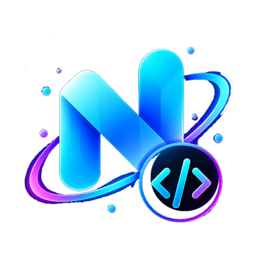

# NobiCode - Code Editor for Android

<p align="center">
  
</p>

## • Overview

Welcome to NobiCode Editor - a powerful and versatile code editing tool designed specifically for Android devices. Whether you're working on HTML, CSS, JavaScript, or other programming languages, NobiCode empowers you to code on-the-go with confidence.

## • Features

- Edit and create websites, and instantly preview them in a browser.
- Seamlessly modify source files for various languages like Python, Java, JavaScript, and more.
- Built-in javascript console
- S/FTP and SSH terminal integration
- Built-in terminal(Alpine)
- Enjoy multi-language editing support with easy management tools.
- Enjoy a large collections of community plugins to enhance your coding experience.

## • Installation

Get NobiCode from the GitHub Actions build artifact in this repository (NobiCode-debug). It is not on Google Play or F-Droid yet.

## • Project Structure

<pre>
NobiCode/
|
|- src/   - Core code and language files
|
|- www/   - Public documents, compiled files, and HTML templates
|
|- utils/ - CLI tools for building, string manipulation, and more
|
|- codemirror-lsp-client/ - Vendored @codemirror/lsp-client source (regular files, no submodule)
</pre>

## • Multi-language Support

Enhance NobiCode's capabilities by adding new languages easily. Just create a file with the language code (e.g., en-us for English) in [`src/lang/`](https://github.com/NobiCode-Foundation/NobiCode/tree/main/src/lang) and include it in [`src/lib/lang.js`](https://github.com/NobiCode-Foundation/NobiCode/blob/main/src/lib/lang.js). Manage strings across languages effortlessly using utility commands:

```shell
pnpm run lang add
pnpm run lang remove
pnpm run lang search
pnpm run lang update
```

## • Contributing & Building the Application

See [CONTRIBUTING.md](CONTRIBUTING.md) for detailed instructions.

## • Contributors

<a href="https://github.com/NobiCode-Foundation/NobiCode/graphs/contributors">
  
</a>

## • Developing a Plugin for NobiCode

For comprehensive documentation on creating plugins for NobiCode Editor, visit the [repository](https://github.com/tale92266-hash/NobiCode).

For plugin development information, refer to: [NobiCode Plugin Documentation](https://github.com/tale92266-hash/NobiCode)

## Star History

<a href="https://star-history.com/#NobiCode-Foundation/NobiCode&Date">
 <picture>
   <source media="(prefers-color-scheme: dark)" srcset="https://api.star-history.com/svg?repos=NobiCode-Foundation/NobiCode&type=Date&theme=dark" />
   <source media="(prefers-color-scheme: light)" srcset="https://api.star-history.com/svg?repos=NobiCode-Foundation/NobiCode&type=Date" />
   
 </picture>
</a>
